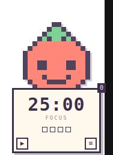

# MiniPomo

A tiny pixel-art pomodoro companion that floats in the corner of your desktop.
It shows the countdown on a little sign the character holds, counts your cycles,
and stays out of the way.



## Download

Grab the file for your system from the [latest release](../../releases/latest):

| System | File | How to install |
| --- | --- | --- |
| Windows | `MiniPomo_*_x64-setup.exe` | Run it. SmartScreen may warn because the app is not code-signed — click **More info → Run anyway**. |
| macOS | `MiniPomo_*_universal.dmg` | Open it, drag MiniPomo into Applications. First launch: **System Settings → Privacy & Security → Open Anyway** (unsigned app). |
| Ubuntu / Debian | `MiniPomo_*_amd64.deb` | Double-click it, or `sudo apt install ./MiniPomo_*_amd64.deb` |
| Other Linux | `MiniPomo_*_amd64.AppImage` | `chmod +x MiniPomo_*.AppImage && ./MiniPomo_*.AppImage` |

### Package managers

**macOS — Homebrew.** This is the smoothest path: Homebrew downloads the app
without the quarantine flag, so there is no Gatekeeper prompt at all.

```bash
brew install --cask alejogalim/minipomo/minipomo
```

**Windows — winget.** The manifest is [in review](https://github.com/microsoft/winget-pkgs/pull/465726);
once merged:

```powershell
winget install Alejogalim.MiniPomo
```

After installing, search for **MiniPomo** in your application menu (on Ubuntu it
lands in the app grid and the Activities search). The `.deb` and `.rpm` also drop
a **MiniPomo** launcher on your Desktop. AppImage users can copy the bundled
desktop entry instead:

```bash
cp /usr/share/applications/MiniPomo.desktop ~/Desktop/ 2>/dev/null || true
```

## Use

- ▶ / ❚❚ in the bottom-left of the sign starts and pauses.
- ≡ in the bottom-right opens the settings panel: reset, change character,
  smaller, larger. The size is remembered.
- Drag by the character or the sign.
- The four pips are the current set of cycles; the badge in the corner is the
  total, kept across restarts.
- Tray icon: Show / Hide, Quit.

Timer: 25 min focus, 5 min short break, 15 min long break after every 4 focus
rounds. A soft blip plays when a phase starts, a three-note chime when it ends,
and the character celebrates.

## Linux notes

- Always-on-top works on X11. On a Wayland session GNOME may ignore it for
  regular apps; log in with "Ubuntu on Xorg" if the widget sinks behind windows.
- The tray icon needs the AppIndicator extension, which Ubuntu ships by default.

## Build from source

Requires Rust, Node 20+ and the Tauri system dependencies
(`libwebkit2gtk-4.1-dev libayatana-appindicator3-dev librsvg2-dev libxdo-dev libdbus-1-dev` on Debian/Ubuntu).

```bash
npm install
npm run dev      # run with hot reload
npm run build    # release build
npm test         # timer logic tests
```

## Project layout

```
ui/            HTML, CSS and JS (no bundler)
  timer.js     pomodoro state machine + tests
  characters.js  16x16 pixel sprites rendered to SVG
src-tauri/     Rust shell: tray, window, drag, size, input region
.github/       release workflow building all three platforms
```

## License

MIT — see [LICENSE](LICENSE).

## Releasing

```bash
git tag v0.1.3 && git push origin v0.1.3   # CI builds all three platforms
```

Then update the package manifests:

- **Homebrew** (`Alejogalim/homebrew-minipomo`): bump `version` and `sha256` in
  `Casks/minipomo.rb` with the new dmg's hash.
- **winget** (`microsoft/winget-pkgs`): copy the previous
  `manifests/a/Alejogalim/MiniPomo/<version>/` folder, bump the version and the
  installer sha256, open a PR.
